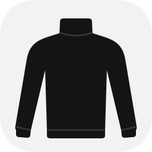

<div align="center">



# turtleneck

turtleneck is a design skill for coding agents that detects what kind of app you are building and gives it a calm, premium, fully responsive UI.

  

[Installation](#installation) · [Presets](#presets) · [Demos](#demos)

</div>

## Highlights

- **Picks the right look first**: reads the request, README, dependencies and routes, decides the page kind and industry, then names one preset and why.
- **Premium core by default**: system font, big tight semibold headlines, generous whitespace, one accent color, flat tiles, frosted nav.
- **Eleven presets on one token set**: each preset is a blend of five large reference sites in its category, written as one CSS file over the same `--a-*` variables; workflow, accessibility and checklist stay the same.
- **Your brand first**: brand colors from you or the project replace the preset accent; the preset keeps layout, type, radii, density, imagery and motion.
- **Responsive at every width**: fluid type and spacing, verified at 320 to 2560 px, phone landscape and 200% zoom with no horizontal scroll.
- **Any stack**: recipes for plain HTML/CSS, Tailwind v3/v4 with shadcn, and SwiftUI.
- **Safe to ship**: free fonts only, no brand logos, photos, copy or proprietary fonts, and no copies of real company sites.

## Installation

```bash
git clone https://github.com/n-stau/turtleneck.git
cd turtleneck
./install.sh
```

The script symlinks the skill into `~/.claude/skills` and `~/.agents/skills`.

## Quick start

Ask for a page or screen as usual. The skill states its pick before it builds:

```text
build a landing page for our music streaming app
restyle this dashboard so it looks premium
make a product page for the new headphones
```

## Presets

Each preset is a blend of five large reference sites in one category, never a copy of one of them.

| Preset | Category | Look |
|---|---|---|
| `keynote` | Premium hardware (default) | White and light grey, big semibold system type, one blue, pill buttons, flat tiles |
| `enterprise` | Business software | Regular-weight headlines, hairline cards, cobalt actions, navy depth |
| `cinema` | Streaming | Blue-black stage, title art under a scrim, poster rows, one indigo CTA |
| `vibe` | Music and social | Dark surfaces, loud color blocks, round pills |
| `power` | Gaming hardware | Dark hero, cyan signal, angular, specs as decoration |
| `devtool` | Developer and cloud | Light pages, hairline 8px cards, deep teal, code as imagery |
| `lab` | AI | Quiet editorial pages, ink buttons, one indigo link color |
| `journey` | Travel | Search-first hero, listing cards, coral highlights, ink pills |
| `market` | Retail | Pill search in a solid nav, flat product grids, orange action, bold prices |
| `vault` | Finance | Navy ink, bordered cards, trust-blue pills, big numbers with fine print |
| `drive` | Automotive | Full-bleed photo scenes, light large headlines, steel blue, square media |

A project's own design system or an explicit style request always wins; brand colors you give replace the preset accent.

## Demos

Eleven demos, one per preset. Each was built by **Claude Sonnet 5.5** from a one-line client brief that named only the product and a brand color; the skill picked the preset and applied the brand color with its contrast rules.

| Demo | Brief | Brand color | Preset |
|---|---|---|---|
| [Lumen Pods](demos/lumen/) | Wireless earbuds product page | `#0F766E` | `keynote` |
| [Brightdesk](demos/brightdesk/) | CRM suite for companies | `#7C3AED` | `enterprise` |
| [Nightfall+](demos/nightfall/) | Thriller and documentary streaming | `#F59E0B` | `cinema` |
| [Loopwave](demos/loopwave/) | Music and social app | `#EC4899` | `vibe` |
| [Arcforge One](demos/arcforge/) | Gaming console with specs | `#F97316` | `power` |
| [Driftbase](demos/driftbase/) | Serverless database for developers | `#10B981` | `devtool` |
| [Hearth & Co](demos/hearth/) | Home goods online shop | `#C2410C` | `market` |
| [Fernbrook Bank](demos/fernbrook/) | Current account and credit card | `#166534` | `vault` |
| [Halden S](demos/halden/) | Electric sedan model page | `#B45309` | `drive` |
| [Quill](demos/quill/) | AI writing assistant | `#0EA5E9` | `lab` |
| [Tidepath](demos/tidepath/) | Stays and experiences booking | `#0D9488` | `journey` |

Run them locally with `python3 -m http.server` in the repo root and open `http://localhost:8000/demos/`.

## Trademarks

The presets describe industry genres, not companies. All demo brands are fictional.

## License

[MIT](LICENSE) © n-stau
